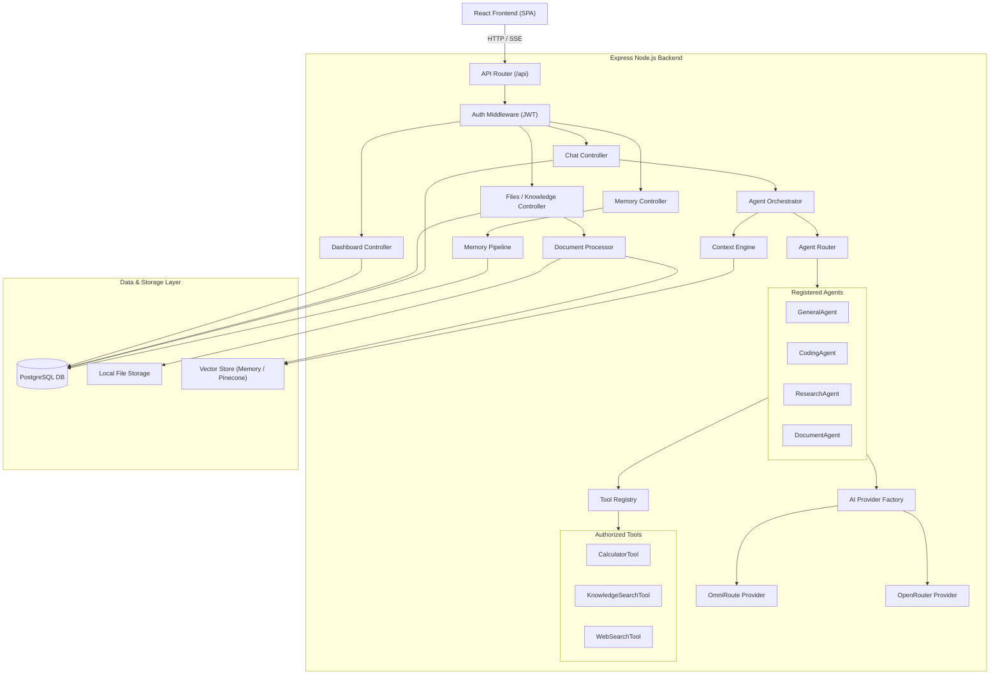
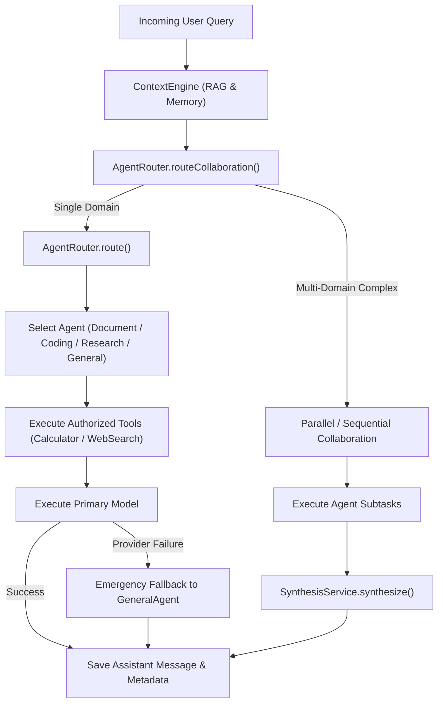
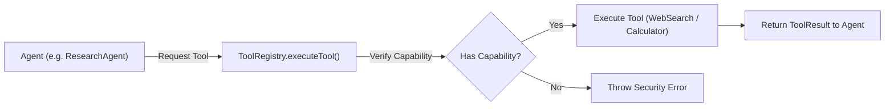
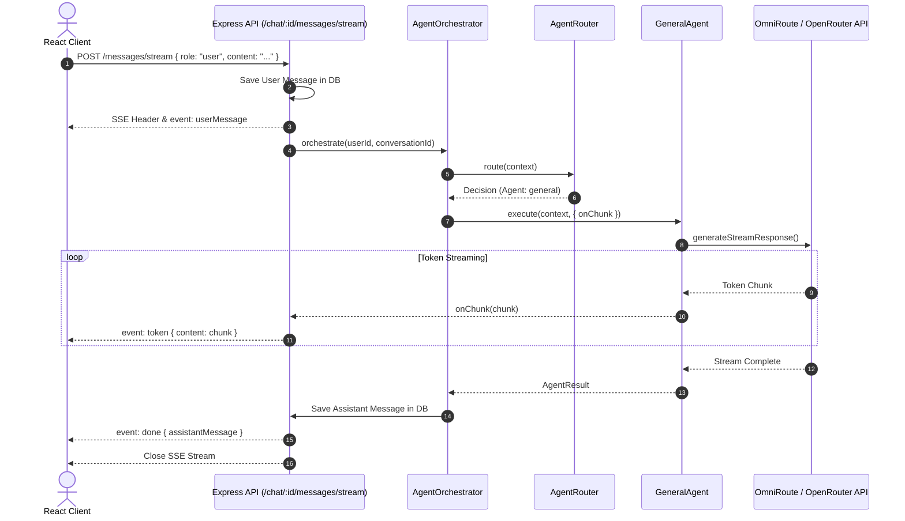
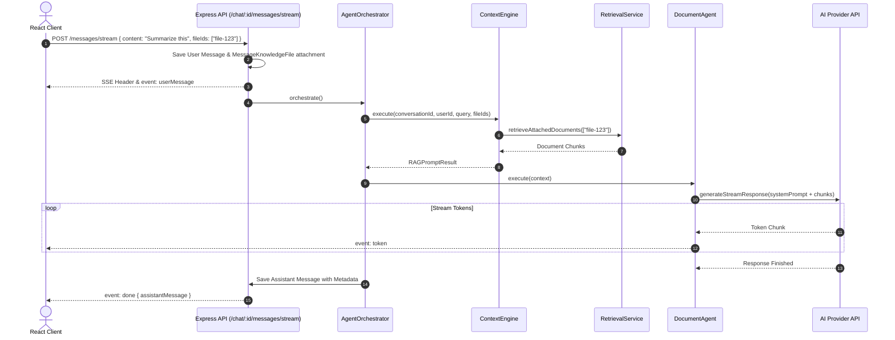

# Synapse — High-Level Design

## 1. Architecture Overview

Synapse is built as a modular multi-tier application comprising a modern Single Page Application (SPA) frontend, a RESTful & Server-Sent Events (SSE) Express API backend, a PostgreSQL database managed via Prisma ORM, an extensible multi-agent orchestration engine, and a dual-provider Vector Search Engine.

```text
┌──────────────────────────────────────────────────────────────────────┐
│                           React Frontend                             │
│       Vite SPA • Tailwind CSS • React Router • Context API           │
└──────────────────────────────────┬───────────────────────────────────┘
                                   │ HTTP REST / SSE Stream
                                   ▼
┌──────────────────────────────────────────────────────────────────────┐
│                        Express Backend API                           │
│   Auth Middleware • Chat Controller • File Processing • Memory Pipeline│
└───────┬──────────────────────────┬───────────────────────────┬───────┘
        │                          │                           │
        ▼                          ▼                           ▼
┌──────────────┐          ┌─────────────────┐        ┌──────────────────┐
│  Context     │          │ Multi-Agent     │        │ Persistent       │
│  Engine      │          │ Orchestrator    │        │ Memory Pipeline  │
└───────┬──────┘          └────────┬────────┘        └─────────┬────────┘
        │                          │                           │
        ▼                          ▼                           ▼
┌──────────────┐          ┌─────────────────┐        ┌──────────────────┐
│ RAG Service &│          │ AI Provider     │        │ PostgreSQL DB    │
│ Vector DB    │          │ Factory         │        │ (Prisma ORM)     │
└──────────────┘          └────────┬────────┘        └──────────────────┘
                                   │
                                   ▼
                          ┌─────────────────┐
                          │ External AI     │
                          │ Gateways        │
                          │ (OmniRoute /    │
                          │ OpenRouter)     │
                          └─────────────────┘
```

---

## 2. System Architecture Diagram



---

## 3. Frontend Architecture

The frontend is a Vite React SPA written in TypeScript.
- **Routing (`src/routes/index.tsx`)**: `react-router-dom` v6 `createBrowserRouter`. Public routes (`/login`, `/signup`) render independently; protected routes (`/dashboard`, `/chat`, `/history`, `/files`, `/settings`) are wrapped in `<ProtectedRoute>` and `<DashboardLayout>`.
- **State Management & Contexts**: `AuthContext` (session auth), `ChatContext` (conversations & streaming), `ThemeContext` (dark/light mode).
- **Feature Modules**: Organized under `src/features/`: `auth`, `chat`, `dashboard`, `files`, `history`, `search`, `settings`.
- **UI Components**: Built using Tailwind CSS and shadcn/ui. Key components include `ConversationWorkspace`, `MessageBubble`, `CodeBlock`, `ContextInspectorDrawer`, and `CitationsList`.

---

## 4. Backend Architecture

The backend is an Express server built with TypeScript following a modular architecture.
- **Entry Point (`src/app.ts`)**: Initializes security headers (`helmet`), CORS, JSON parsing, logging (`requestLogger`), feature routers under `/api`, and central error handling (`errorHandler`).
- **Route Modules**: `/api/auth`, `/api/chat`, `/api/files`, `/api/memory` & `/api/workspace-memory`, `/api/search`, `/api/dashboard`.
- **Error Handling**: Centralized `ApiError` class with operational HTTP status codes (400, 401, 403, 404, 429, 500, 502).

---

## 5. AI Architecture

The AI layer abstracts LLM providers, manages model fallbacks, routes prompt intent, and orchestrates single or multi-agent collaboration workflows.



### 5.1 Provider Factory & Agent Framework
- **Provider Factory (`features/ai/factory/providerFactory.ts`)**: Maps `AI_PROVIDER` (`omniroute` or `openrouter`) to instances implementing `AIProvider`.
- **Agent Registry (`AgentRegistry`)**: Singleton registry managing active agents (`general`, `coding`, `research`, `document`).
- **Agent Router (`AgentRouter`)**: Deterministic intent routing (`DocumentAgent` > `CodingAgent` > `ResearchAgent` > `GeneralAgent`).
- **Agent Orchestrator (`AgentOrchestrator`)**: Assembles context, executes primary/collaborative agents, executes tools, manages fallbacks, and triggers background memory extraction.

---

## 6. RAG Architecture

Message-level file isolation, multi-format document parsing, semantic chunking, and dual vector indexing:
- **Document Processing**: `PdfParser` (`pdf-parse`), `DocxParser` (`mammoth`), `MarkdownParser`, `TxtParser`.
- **Semantic Chunking**: Splits text into sliding window chunks of ~500 tokens with 50-token overlap (`SemanticChunker`).
- **Vector Indexing**: Computes embeddings and indexes vectors into `MemoryVectorProvider` or `PineconeVectorProvider`.
- **File Isolation**: Priority 1 message attachments (`MessageKnowledgeFile`) take exclusive priority over conversation files (`ConversationKnowledgeFile`).

---

## 7. Memory Architecture

Multi-scoped persistent memory system maintaining user preferences and workspace rules:
- **Scopes**: `GLOBAL` (user-wide), `WORKSPACE` (project rules), `CONVERSATION` (chat session).
- **Memory Types**: `INSTRUCTION`, `PREFERENCE`, `FACT`, `CONSTRAINT`, `PROJECT_CONTEXT`, `SUMMARY`.
- **Memory Pipeline**: Command parsing (`"Remember..."`, `"Forget..."`), auto-detection, secret scanning (`containsSensitiveInfo`), and conflict archiving.

---

## 8. Tool Architecture

Tools extend agent capabilities through permission checks.



- `ToolRegistry`: Validates that calling agent possesses required `AgentCapability`.
- **Registered Tools**: `CalculatorTool` (`calculator`), `KnowledgeSearchTool` (`knowledge.search`), `WebSearchTool` (`web.search`).

---

## 9. Authentication & Authorization

- **Authentication**: Credentials validated during `/api/auth/login`. Returns signed JWT containing `{ sub: user.id, email: user.email }`.
- **Authorization**: `authenticate` middleware verifies `Authorization: Bearer <token>` header.
- **Tenant Ownership**: Controllers enforce resource isolation by filtering queries with `userId: req.user.sub`.

---

## 10. Data Flow

### 10.1 Normal Chat SSE Flow



### 10.2 Document / RAG Chat SSE Flow



---

## 11. External Integrations & Deployment

- **External Integrations**: OmniRoute / OpenRouter API, PostgreSQL DB, local disk storage, Pinecone Vector DB.
- **Deployment Architecture**: Currently implemented as local Node.js Express server + Vite SPA; containerized Docker Compose deployment planned.
- **Scalability**: Stateless JWT auth for horizontal scaling, Prisma connection pooling, and background async file chunking.
