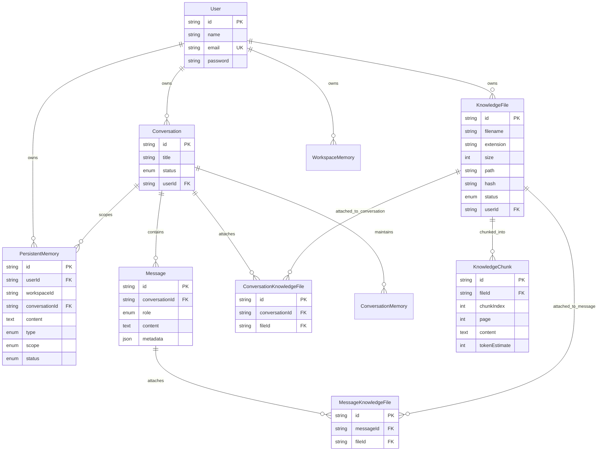

# Synapse — Low-Level Design

## 1. Project Structure

```text
synapse/
├── app/
│   ├── backend/
│   │   ├── prisma/
│   │   │   └── schema.prisma           # Prisma database schema definition
│   │   ├── src/
│   │   │   ├── app.ts                  # Express application setup
│   │   │   ├── config/env.ts           # Zod-validated environment variables
│   │   │   ├── features/               # Modular feature domains
│   │   │   │   ├── agents/             # Agent orchestrator, router, registry, agents & tools
│   │   │   │   ├── ai/                 # Provider factory & LLM providers (OmniRoute, OpenRouter)
│   │   │   │   ├── auth/               # Auth controller, middleware, service & validation
│   │   │   │   ├── chat/               # Chat controller, routes, service & SSE handlers
│   │   │   │   ├── context/            # Context engine & intent classifier
│   │   │   │   ├── dashboard/          # Dashboard stats service & controller
│   │   │   │   ├── document-processing/# Document parsers, text normalizer & semantic chunker
│   │   │   │   ├── files/              # File upload, preview, download controllers
│   │   │   │   ├── memory/             # Persistent memory service & pipeline
│   │   │   │   ├── rag/                # Retrieval, context, prompt builder & citation services
│   │   │   │   ├── search/             # Semantic & keyword search services
│   │   │   │   └── workspace-memory/   # Workspace memory CRUD operations
│   │   │   ├── lib/                    # Storage, Prisma client & Vector providers
│   │   │   ├── middleware/             # Error handler & request logger
│   │   │   └── utils/ApiError.ts       # Operational ApiError class
│   │   └── storage/                    # Local file storage upload directory
│   └── frontend/
│       ├── src/
│       │   ├── App.tsx                 # Root React Router provider
│       │   ├── components/             # UI primitives (shadcn/ui, sidebar, background)
│       │   ├── contexts/               # ThemeContext
│       │   ├── features/               # Frontend features (auth, chat, dashboard, files, history, search, settings)
│       │   ├── layouts/                # RootLayout, DashboardLayout
│       │   └── routes/index.tsx        # React Router definition
```

---

## 2. Database Design

Synapse uses PostgreSQL as its relational store managed via Prisma ORM (`app/backend/prisma/schema.prisma`).

### 2.1 Entity Relationship Diagram



### 2.2 Prisma Enums & Models
- **Enums**: `MessageRole` (`user`, `assistant`, `system`), `FileStatus` (`uploaded`, `processing`, `processed`, `failed`), `PersistentMemoryScope` (`GLOBAL`, `WORKSPACE`, `CONVERSATION`), `PersistentMemoryType` (`INSTRUCTION`, `PREFERENCE`, `FACT`, `CONSTRAINT`, `PROJECT_CONTEXT`, `SUMMARY`), `PersistentMemoryStatus` (`ACTIVE`, `ARCHIVED`).
- **Core Models**:
  - `User`: Primary user entity. Unique constraint on `email`.
  - `Conversation`: Chat session owned by `User`. Has cascade deletion on messages and attached file relations. Index: `[userId]`.
  - `Message`: Chat message record storing role, text content, and JSON `metadata` (strategy stats, agent traces, citations). Index: `[conversationId]`.
  - `KnowledgeFile`: Metadata for uploaded files. Unique constraint on `[userId, hash]` prevents duplicate uploads.
  - `MessageKnowledgeFile`: Join table linking `Message` to `KnowledgeFile` for **message-level file isolation**. Unique constraint: `[messageId, fileId]`.
  - `ConversationKnowledgeFile`: Join table linking `Conversation` to `KnowledgeFile` for conversation context. Unique constraint: `[conversationId, fileId]`.
  - `KnowledgeChunk`: Text chunk records generated by `SemanticChunker`. Stores `page`, `chunkIndex`, and `tokenEstimate`. Indexes: `[fileId]`, `[chunkIndex]`.
  - `PersistentMemory`: Multi-scoped persistent rules and preferences. Indexes: `[userId]`, `[userId, workspaceId]`, `[userId, scope, status]`, `[conversationId]`.

---

## 3. API Design

All protected endpoints require HTTP Header `Authorization: Bearer <jwt_token>`.

### 3.1 REST API Endpoints

| Category | Method & Endpoint | Auth Required | Description |
| :--- | :--- | :--- | :--- |
| **Auth** | `POST /api/auth/signup` | No | Register new user account. Body: `{ name, email, password }`. |
| **Auth** | `POST /api/auth/login` | No | Authenticate user. Body: `{ email, password }`. Returns JWT token. |
| **Auth** | `GET /api/auth/me` | Yes | Get authenticated user profile. |
| **Auth** | `PATCH /api/auth/profile` | Yes | Update user profile name or email. |
| **Auth** | `PATCH /api/auth/password` | Yes | Change user password. |
| **Chat** | `GET /api/chat` | Yes | List active conversations for current user. |
| **Chat** | `POST /api/chat` | Yes | Create a new conversation. Body: `{ title? }`. |
| **Chat** | `PATCH /api/chat/:id` | Yes | Rename or archive conversation. |
| **Chat** | `DELETE /api/chat/:id` | Yes | Delete conversation and associated messages/attachments. |
| **Chat** | `GET /api/chat/:id/messages` | Yes | Fetch paginated message history. Params: `cursor`, `limit`. |
| **Chat SSE** | `POST /api/chat/:id/messages/stream` | Yes | **Primary SSE Stream**. Body: `{ role: "user", content, fileIds? }`. |
| **Chat SSE** | `POST /api/chat/:id/messages/regenerate` | Yes | **SSE Regeneration Stream**. Truncates trailing assistant response. |
| **Files** | `POST /api/files/upload` | Yes | Multipart file upload (`multer`). Parses & enqueues chunking. |
| **Files** | `GET /api/files` | Yes | List uploaded files. |
| **Files** | `GET /api/files/available` | Yes | List available files eligible for message attachment. |
| **Files** | `GET /api/files/:id/preview` | Yes | Preview raw parsed file text. |
| **Files** | `GET /api/files/:id/download` | Yes | Download raw file binary. |
| **Files** | `DELETE /api/files/:id` | Yes | Delete file and remove associated vector chunks. |
| **Memory** | `GET /api/workspace-memory` | Yes | Get active workspace memories and persistent instructions. |
| **Memory** | `POST /api/workspace-memory` | Yes | Create persistent instruction manually. |
| **Memory** | `PATCH /api/workspace-memory/:memoryId` | Yes | Edit memory content, priority, or pinned status. |
| **Memory** | `DELETE /api/workspace-memory/:memoryId` | Yes | Archive or hard-delete memory. |
| **Dashboard** | `GET /api/dashboard/stats` | Yes | Return aggregated stats (conversations, files, bytes, memories, models, activity). |
| **Search** | `POST /api/search/semantic` | Yes | Vector search over user documents. |
| **Search** | `POST /api/search/conversation` | Yes | Keyword search across user chat messages. |

---

## 4. Authentication Implementation

Authentication relies on `bcryptjs` and `jsonwebtoken`:
- **Password Hashing**: `bcrypt.hash(password, 10)` before database insertion.
- **JWT Issuance**: Signed with `env.JWT_SECRET` for 7-day expiration (`{ sub: user.id, email: user.email }`).
- **Auth Middleware (`features/auth/auth.middleware.ts`)**:
  ```typescript
  export function authenticate(req: Request, res: Response, next: NextFunction) {
    const authHeader = req.headers.authorization;
    if (!authHeader?.startsWith('Bearer ')) return next(new ApiError(401, 'Token required'));
    try {
      const payload = jwt.verify(authHeader.split(' ')[1], env.JWT_SECRET) as { sub: string; email: string };
      req.user = payload;
      next();
    } catch {
      next(new ApiError(401, 'Invalid or expired token'));
    }
  }
  ```

---

## 5. Streaming Implementation

Real-time response token streaming is implemented using Server-Sent Events (SSE):

```typescript
res.setHeader('Content-Type', 'text/event-stream');
res.setHeader('Cache-Control', 'no-cache, no-transform');
res.setHeader('Connection', 'keep-alive');
res.setHeader('X-Accel-Buffering', 'no');

const abortController = new AbortController();
res.on('close', () => {
  if (!res.writableEnded) abortController.abort();
});

res.write(`data: ${JSON.stringify({ type: 'userMessage', userMessage })}\n\n`);

const keepaliveInterval = setInterval(() => {
  if (!res.writableEnded) res.write(': keepalive\n\n');
}, 8000);

const onChunk = (chunk: string) => {
  if (!res.writableEnded) {
    res.write(`data: ${JSON.stringify({ type: 'token', content: chunk })}\n\n`);
  }
};
```

---

## 6. Agent & Tool System Implementation

### 6.1 Agent Contracts & Registry (`features/agents/`)

```typescript
export interface AgentContext {
  userId: string;
  conversationId: string | null;
  query: string;
  history: ChatMessageInput[];
  messageFileIds: string[];
  ragResult?: RAGPromptResult;
}

export interface AgentResult {
  agentId: string;
  status: 'success' | 'failure';
  content: string;
  citations?: Citation[];
  toolCalls?: ToolCallResult[];
  agentMeta?: AgentExecutionMeta;
  durationMs: number;
}

export interface Agent {
  id: string;
  name: string;
  description: string;
  capabilities: AgentCapability[];
  canHandle(context: AgentContext): Promise<CanHandleResult>;
  execute(context: AgentContext, options?: AgentExecutionOptions): Promise<AgentResult>;
}
```

- **Registered Agents**:
  1. `GeneralAgent` (`general`): Standard conversational reasoning. Capabilities: `conversation.read`, `memory.read`, `calculator.execute`.
  2. `CodingAgent` (`coding`): Code review, debugging, SQL query design. Capabilities: `conversation.read`, `knowledge.read`, `code.execute`, `calculator.execute`.
  3. `ResearchAgent` (`research`): Trade-off analysis, technical comparison. Capabilities: `conversation.read`, `knowledge.read`, `web.search`.
  4. `DocumentAgent` (`document`): Attached file summarization, chunk extraction. Capabilities: `conversation.read`, `knowledge.read`.

### 6.2 Tool Implementation (`features/agents/tools/`)
- `ToolRegistry`: Verifies capability permissions before executing tool implementations.
- **Tools**:
  1. `CalculatorTool` (`calculator`): Evaluates arithmetic and percentage expressions without `eval()`.
  2. `KnowledgeSearchTool` (`knowledge.search`): Vector queries user knowledge chunks.
  3. `WebSearchTool` (`web.search`): Fetches web search results and formats citations.

---

## 7. Document Processing & File Isolation

1. **Ingestion (`DocumentProcessorService`)**: Asynchronously triggered upon upload (`enqueue`).
2. **Parsing (`ParserFactory`)**: Converts PDF (`pdf-parse`), DOCX (`mammoth`), Markdown, or TXT into plain text.
3. **Normalization & Chunking**: `TextNormalizer` standardizes whitespace; `SemanticChunker` creates ~500-token sliding window chunks with 50-token overlap.
4. **Transaction & Vector Indexing**: Prisma `$transaction` updates `KnowledgeFile` status to `processed` and creates `KnowledgeChunk` rows. `embeddingService` computes vector embeddings into `MemoryVectorProvider` or `PineconeVectorProvider`.
5. **Message-Level File Isolation (`ContextEngine`)**:
   - If `messageFileIds` exist, RAG retrieval target is restricted **exclusively** to those file IDs.
   - If `messageFileIds` empty, `IntentClassifier.detectPriorContextReference()` checks for explicit user keywords to determine if prior conversation files should be searched.
   - Otherwise, RAG retrieval is bypassed.

---

## 8. Memory System & Security Rules

- **Secret Protection (`containsSensitiveInfo`)**: Input strings are scanned against regular expressions rejecting passwords, API keys (`sk-`, `ghp_`), bearer tokens, and credentials.
- **Priority Ranking**: Persistent memories are assigned default priorities (`INSTRUCTION` = 10, `CONSTRAINT` = 9, `PROJECT_CONTEXT` = 7, `PREFERENCE` = 6, `FACT` = 5). Instructions and pinned items are injected first.
- **Tech Conflict Archiving (`resolveConflictingMemories`)**: Automatically archives active rules containing conflicting framework terms (e.g. PostgreSQL vs MySQL) upon new rule insertion.

---

## 9. Error Handling & Environment Configuration

- **Operational Error Handling**: Represented by `ApiError(statusCode, message)` and caught by Express `errorHandler` middleware.
- **Emergency GeneralAgent Fallback**: If a specialized agent encounters provider failures (429, 502, 503, rate limits), `AgentOrchestrator` automatically retries execution using `GeneralAgent`.
- **Environment Configuration (`src/config/env.ts`)**: Validated via Zod: `DATABASE_URL`, `JWT_SECRET`, `AI_PROVIDER` (`omniroute` | `openrouter`), `OMNIROUTE_API_KEY`, `OPENROUTER_API_KEY`, `GENERAL_AGENT_MODEL`, `CODING_AGENT_MODEL`, `RESEARCH_AGENT_MODEL`, `DOCUMENT_AGENT_MODEL`, `VECTOR_PROVIDER` (`memory` | `pinecone`), `PORT`, `CORS_ORIGIN`.

---

## 10. Important Implementation Decisions

1. **Provider Factory Pattern**: Decouples LLM provider integrations from business logic via a unified `AIProvider` interface.
2. **Message-Level File Isolation**: Resolves context bleed in RAG by prioritizing current message attachments exclusively over global conversation files.
3. **Deterministic Agent Routing**: Eliminates non-deterministic LLM classifier latency by prioritizing document attachments, code error patterns, and research intent before fallback.
4. **Dual Vector Search Engine**: Enables zero-dependency local development via `MemoryVectorProvider` while supporting cloud vector scaling via `PineconeVectorProvider`.
